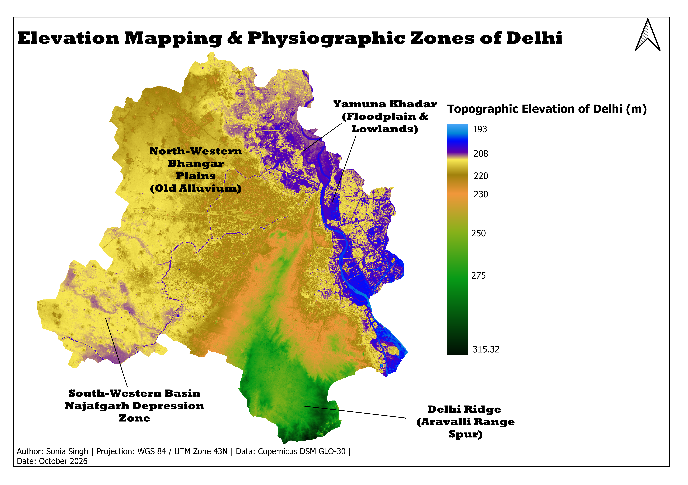
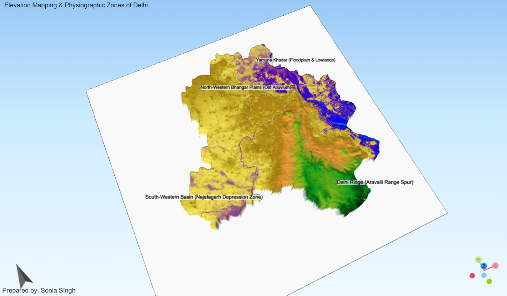

# Elevation_Mapping_and_Physiographic_Zones_of_Delhi
Copernicus DEM: 2D and 3D Topographic Study of Delhi
## Spatial & Topographic Analysis of Delhi (Copernicus DEM)
Spatial analysis, topographic mapping, and 3D terrain modeling of Delhi (NCT) using Copernicus DEM in QGIS. Features 4-tier physiographic zone classification, 2D publication-ready cartographic layout design, and an interactive 3D WebGL terrain model export via Qgis2threejs for topographic research.

## Overview
Physiographic classification and terrain modeling of the National Capital Territory (NCT) of Delhi using Copernicus Digital Elevation Model (DEM) data to delineate key landform divisions and elevation profiles.

## Dataset & Metadata
- **Data Source:** Copernicus DEM (GLO-30) / European Space Agency (ESA)

- **Spatial Resolution:** 30 meters

- **Vertical Datum:** EGM2008 Geoid

- **Target Area:** National Capital Territory of Delhi (NCT)

## Workflow & Methodology
1. **Data Acquisition:** Copernicus DEM GLO-30 tiles.
2. **Pre-processing:** Merged DEM tiles and clipped raster to Delhi administrative boundary.
3. **Physiographic Classification:** Identified and delineated 4 primary landform zones based on elevation and terrain characteristics:
   - **Delhi Ridge (Aravalli Range Spur):** Elevated rocky structure forming the south and central spine.
   - **Yamuna Khadar:** Active floodplain and lowlands along the Yamuna river corridor.
   - **North-Western Bhangar Plains:** Elevated older alluvial plains.
   - **South-Western Basin (Najafgarh Depression):** Low-lying drainage basin area.
4. **2D Map Design:** Configured elevation pseudocolor symbology and designed the final map layout in QGIS Print Layout.
5. **3D WebGL Modeling:** Exported the 3D scene using Qgis2threejs with vertical exaggeration and custom 3D floating billboard label height offsets.

## Output Map Layout

## 3D WebGL Model Preview

## Interactive 3D Model Viewer
The interactive 3D terrain model is hosted live on GitHub Pages:  
[View Live 3D Model](https://ss99-builds.github.io/Elevation_Mapping_and_Physiographic_Zones_of_Delhi/)

## Disclaimer & Contributions
This is an independent exploratory analysis created as part of learning QGIS and 3D spatial visualization workflows. Since this is an initial work by a beginner, there may be oversights or methodological limitations. Feedback, corrections, and suggestions for improvement are most welcome! Feel free to open an issue or submit a pull request.

